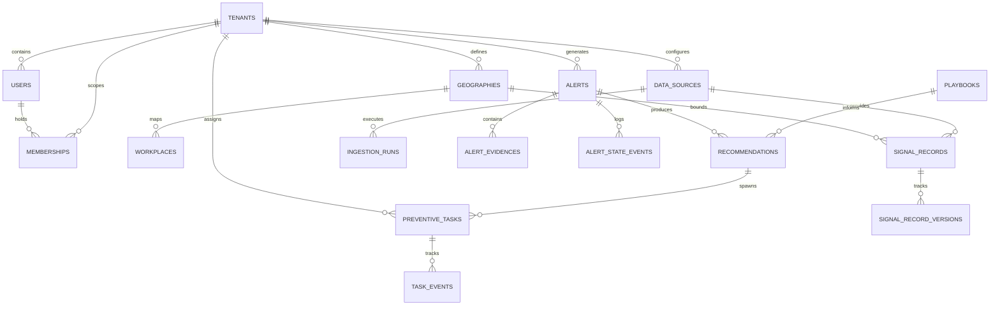
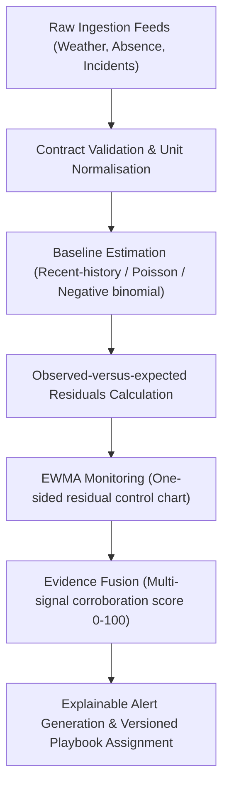

# SentinelHealth Architecture & System Design

## 1. System Overview
SentinelHealth is designed as a modular monolith API paired with asynchronous Celery background workers and a single Celery Beat scheduler. It operates on a time-aligned, geographically bounded surveillance pipeline.

---

## 2. Entity-Relationship Model (ERD)



---

## 3. Row-Level Security (RLS) Architecture
PostgreSQL Row-Level Security is strictly enforced on all tenant-isolated tables (`signal_records`, `alerts`, `preventive_tasks`, `audit_events`, `feature_windows`, `workplaces`, `geographies`).
The application connects via a non-superuser role `sentinel_app` and sets a transaction-local setting:
```sql
SELECT set_config('app.current_tenant_id', '11111111-1111-1111-1111-111111111111', true);
```
Views `observations` and `tasks` are created `WITH (security_invoker = true)` so PostgreSQL evaluates the underlying base-table RLS policies against the invoker role (`sentinel_app`), ensuring view access matches table access without privilege escalation.

---

## 4. Surveillance & Analytics Pipeline



> [!NOTE]
> **Baselines vs. Monitoring**: EWMA is a monitoring control chart statistic that weights recent observations more heavily; it is strictly distinguished from the count-regression model (Poisson/Negative Binomial) that estimates expected baseline values.

---

## 5. Database Roles & Privilege Separation

To ensure Row-Level Security cannot be bypassed by runtime connections:
1. **Migration Owner (`sentinel_migrator`)**:
   - DDL schema owner, executes Alembic migrations.
   - Creates tables, indexes, and applies `ENABLE ROW LEVEL SECURITY` and `FORCE ROW LEVEL SECURITY`.
   - *Security Scope Note*: `FORCE ROW LEVEL SECURITY` subjects ordinary owner queries to policies, but superusers and `BYPASSRLS` roles still bypass them; the table owner also retains schema authority to alter or drop policies. Therefore, runtime execution must never connect as the table owner.
2. **Runtime Application User (`sentinel_app`)**:
   - Restricted DML role (`SELECT, INSERT, UPDATE, DELETE`) with `NOBYPASSRLS`.
   - Never granted superuser or schema DDL ownership; granted only `USAGE` on schema `public`.
   - Connected via pooled asyncpg connections with transaction-local `SET LOCAL app.current_tenant_id` scoping and explicit connection return cleanup (`RESET app.current_tenant_id`).

---

## 6. Authentication Bootstrapping, Trust Boundaries, & Shared Credential Risks

### Validated Token Resolution
- Authentication relies strictly on cryptographically verified OIDC access tokens (RS256) issued by the configured identity provider (`KEYCLOAK_URL/realms/sentinel`).
- The application extracts user identity from the validated `sub` and `iss` claims. Untrusted client headers like `X-Tenant-ID` can only switch the active session between tenants in which the user already possesses an active, verified database membership in `memberships`. If a user attempts to supply an unassigned `X-Tenant-ID`, the request is immediately rejected with HTTP 403 Forbidden.

### Minimised Data Exposure
- While `sentinel_app` has `SELECT` privileges on `users` and `memberships` to resolve incoming JWT tokens to authorized tenant UUIDs before setting `app.current_tenant_id`, API endpoints restrict user responses strictly to the authenticated subject's own active memberships and roles.
- Non-admin users cannot enumerate other organizations, query foreign memberships, or inspect global user directories.

### Role & Membership Immutability
- Runtime endpoints for public health analysts and workplace safety managers have zero privileges to modify their own roles or insert membership rows. Role escalation attempts via API are rejected.

### Trust Boundary Analysis of `app.current_tenant_id`
- **Session Variable Boundary**: `app.current_tenant_id` is a PostgreSQL session configuration setting (`GUC`), **not** an end-to-end cryptographic isolation boundary.
- **Application Trust Assumption**: The isolation model trusts the FastAPI middleware and database session dependency to set `set_config('app.current_tenant_id', <tenant_uuid>, true)` at transaction start and execute `set_config('app.current_tenant_id', '', false)` before connection release.
- **Shared Runtime Credential Threat Vector**:
  Because all application workers connect to PostgreSQL using the shared runtime credential `sentinel_app`, an adversary who achieves arbitrary SQL injection could theoretically forge an `app.current_tenant_id` setting to inspect a victim tenant's rows, because `sentinel_app` has table-level `SELECT` grants across the database.
- **Defense-in-Depth Mitigations**:
  1. SQL parameterization is enforced everywhere via SQLAlchemy Core/ORM and asyncpg prepared statements; string formatting into SQL is strictly forbidden.
  2. Without an explicit tenant context setting, queries on all protected tables return 0 rows (`UPDATE` affects 0 rows, `INSERT` raises `InsufficientPrivilegeError`).
  3. Pooled connections clear all session state on release.
  4. In regulated high-assurance environments, physical database separation (separate PostgreSQL databases or schemas with separate credentials per tenant) should supersede shared RLS.

---

## 7. Resource Estimates (Unverified Until Formally Measured)

> [!WARNING]
> All resource and startup figures below are **unverified engineering estimates**. They must not be treated as formal acceptance promises until live container execution, build caches, and stress loads are measured on target hardware.

| Resource | Unverified Estimate | Measurement Notes |
| :--- | :--- | :--- |
| **Compose Stack RAM** | ~1.5 GB – 2.0 GB | Measured across Postgres (256MB), Redis (64MB), Keycloak (512MB heap), FastAPI (150MB), Celery (200MB), Frontend Nginx (30MB). |
| **Disk Storage** | ~3.5 GB – 4.5 GB | Base Python 3.12, Node 22, and PostGIS container images plus local npm and uv package caches. |
| **Cold Startup Time** | ~30 – 45 seconds | Ordered via Docker Compose healthchecks (`service_healthy` and `service_completed_successfully` on migration) rather than fixed sleeps. |

---

## Prototype Disclaimer
*This prototype has not undergone clinical validation, production security assessment or jurisdiction-specific legal/compliance review.*
