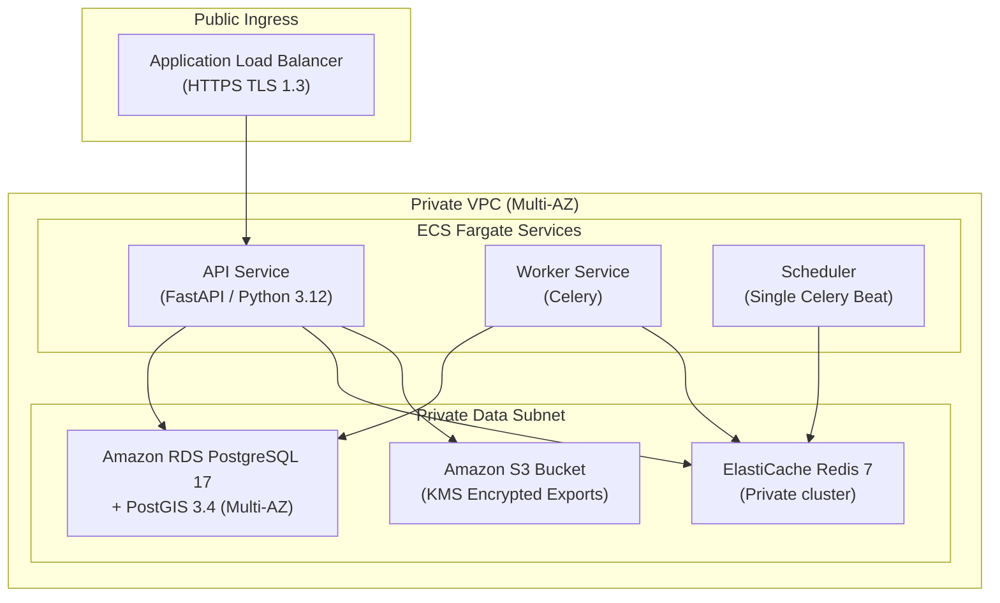

# SentinelHealth Deployment Guide: Local & AWS Pilot

## 1. Local Development (Docker Compose)
Prerequisites: Docker Engine 24+, Docker Compose v2.20+, 4GB available RAM.

```bash
# 1. Clone & Setup
git clone <repo-url> sentinelhealth
cd sentinelhealth
cp .env.example .env

# 2. Start stack
make up

# 3. Apply database migrations
make migrate

# 4. Seed demonstration dataset
make seed-demo

# 5. Execute smoke tests
make smoke
```

Access Points:
- Web Application: `http://localhost:8080`
- API OpenAPI Docs: `http://localhost:8080/docs`
- Keycloak Identity: `http://localhost:8081`
- Mailpit Email UI: `http://localhost:8025`

---

## 2. AWS Pilot Deployment Architecture



### AWS Pilot Cost Worksheet (Monthly Estimate)
| Component | Specification | Estimated Monthly Cost |
|---|---|---|
| **ECS Fargate (API + Workers)** | 3 tasks × 0.5 vCPU, 1GB RAM | ~$35.00 |
| **RDS PostgreSQL + PostGIS** | db.t4g.medium, 50GB gp3 storage | ~$65.00 |
| **ElastiCache Redis** | cache.t4g.micro | ~$15.00 |
| **Application Load Balancer** | 1 ALB with standard LCU traffic | ~$22.00 |
| **NAT Gateway** | 1 single-AZ NAT for outbound feeds | ~$32.00 |
| **S3 + CloudWatch + Secrets Manager** | Encrypted exports, structured logs | ~$12.00 |
| **Total Estimated Pilot Cost** | | **~$181.00 / month** |

